# MedGuide

**The rank opens the door. The right choice gets you through.**

<p>
  <a href="https://medguide-beryl.vercel.app/"><b>🔗 Live demo: medguide-beryl.vercel.app</b></a>
</p>

MedGuide is a NEET-UG counselling companion for students and parents, from the day results are out to the day you join a college.

<p align="center">
  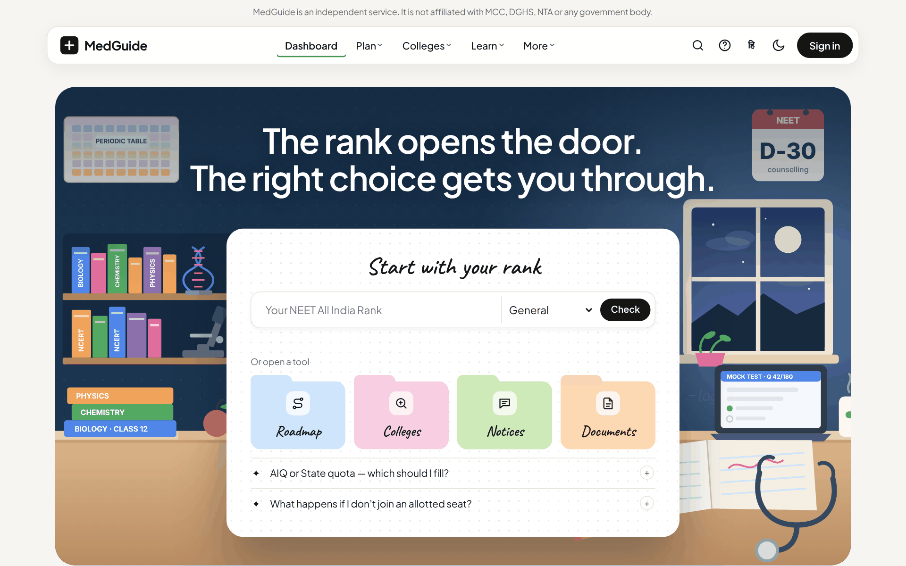
</p>

## Demo

<p align="center">
  <a href="docs/demo/medguide-demo.mp4">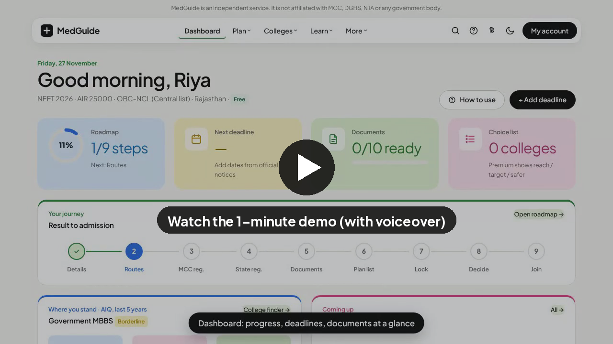</a>
</p>

A 1-minute walkthrough of every feature, with voiceover: [`docs/demo/medguide-demo.mp4`](docs/demo/medguide-demo.mp4). Or try it live at [medguide-beryl.vercel.app](https://medguide-beryl.vercel.app/).

## Why MedGuide

Every year over 22 lakh students register for NEET-UG and about 11 lakh qualify, for roughly 1.65 lakh MBBS and BDS seats. A good rank is only half the job. The other half is counselling:

- **Two parallel systems.** All India Quota (run by MCC) and State quota (34 different State/UT authorities) each have their own registration, fees and rules.
- **Multiple rounds with strict, changing deadlines.** One missed date or a badly ordered choice list can cost a seat, or a forfeited security deposit.
- **Rules and updates buried in long documents.** They sit in a long Information Bulletin and a stream of PDF notices, full of terms like *float*, *freeze*, *upgradation* and *stray vacancy*.
- **Paid help is expensive.** Many students turn to costly counsellors or rely on WhatsApp forwards.

MedGuide turns all of this into one clear, personal plan.

## How it works

1. **Tell it about yourself.** Add your rank, category, domicile State and course preference. Everything stays in your own browser.
2. **Get your roadmap.** MedGuide works out which counselling routes apply to you, which documents and certificates you need, and lists every step from registration to reporting. Progress ticks itself as you go.
3. **See where your rank stands.** Compare your AIR with five years of closing ranks, round by round, for All India and State quota. MedGuide never promises a seat.
4. **Stay on top of every update.** Upload any official notice PDF and get a one-line summary, whether it applies to you, and its dates added to your deadlines. Reminders work through your calendar, WhatsApp or SMS.
5. **Practise before the real thing.** Build and compare your choice list, then lock it in a timed mock round that behaves like the MCC portal.

Rules are summarised from the official MCC UG Counselling 2026 Information Bulletin, and every page links back to the official source to confirm.

> MedGuide is an independent project. It is not affiliated with MCC, DGHS, NTA or any government body. Always confirm dates and rules on [mcc.nic.in](https://mcc.nic.in) or your State counselling authority.

## Features

| | |
|---|---|
| **Dashboard** | Roadmap progress, next deadline, document readiness and choice-list balance at a glance. |
| **Personal roadmap** | Every step from result to joining, ticked automatically from your data. |
| **College finder** | Your AIR against 5 years (2021–2025) of All India Quota closing ranks, round-wise 2025 ranks, State-wise government colleges and BDS options. |
| **Counselling guide** | AIQ vs State counselling, side-by-side comparison, rules and fees, what to do after allotment, and links to all 34 State/UT counselling authorities. |
| **Explain a notice** | Upload an MCC/State notice PDF (or paste text) to get a one-line summary, whether it applies to you, and its dates added to your deadlines in one click. |
| **Deadlines** | Due-soon warnings on every page, calendar export (`.ics`), and WhatsApp/SMS reminders. |
| **Documents** | A checklist filtered to your category; a document counts as ready only once its scan is uploaded. Download everything as one ZIP. |
| **Choice list** | Ordered drafts, a college comparison with fees and bond details, and a timed mock choice-filling practice. |
| **Help & experts** | Searchable Q&A, expert session requests and the official MCC video tutorials. |
| **Institute view** | A batch dashboard for coaching institutes (demo data). |
| **Everywhere** | English and Hindi, light and dark themes, a Ctrl + K command palette, a read-only parent link, and a mobile-friendly layout. |

## Screenshots

<table>
  <tr>
    <td width="50%">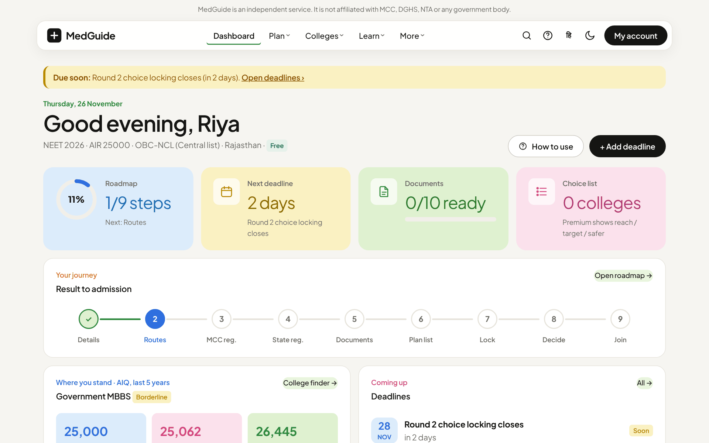<p align="center"><b>Dashboard</b></p></td>
    <td width="50%">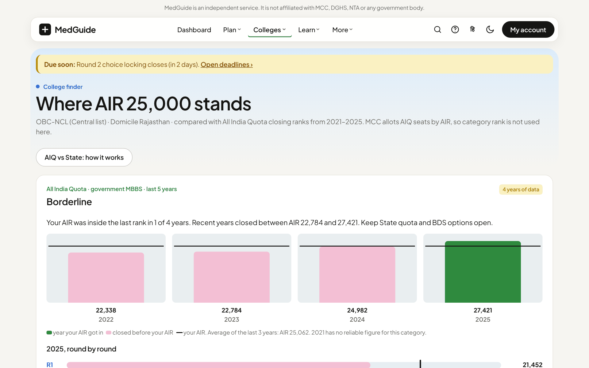<p align="center"><b>College finder</b></p></td>
  </tr>
  <tr>
    <td>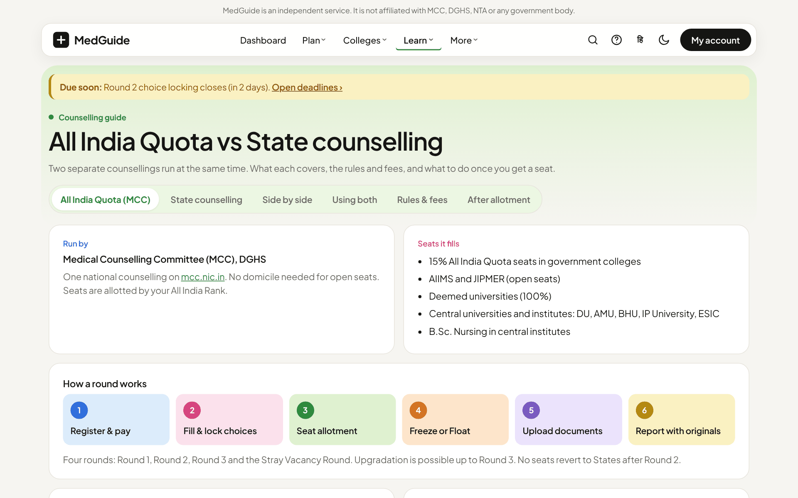<p align="center"><b>Counselling guide</b></p></td>
    <td>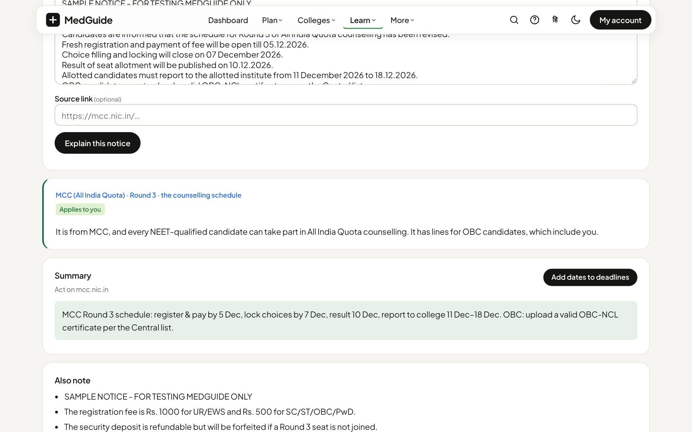<p align="center"><b>Explain a notice</b></p></td>
  </tr>
  <tr>
    <td>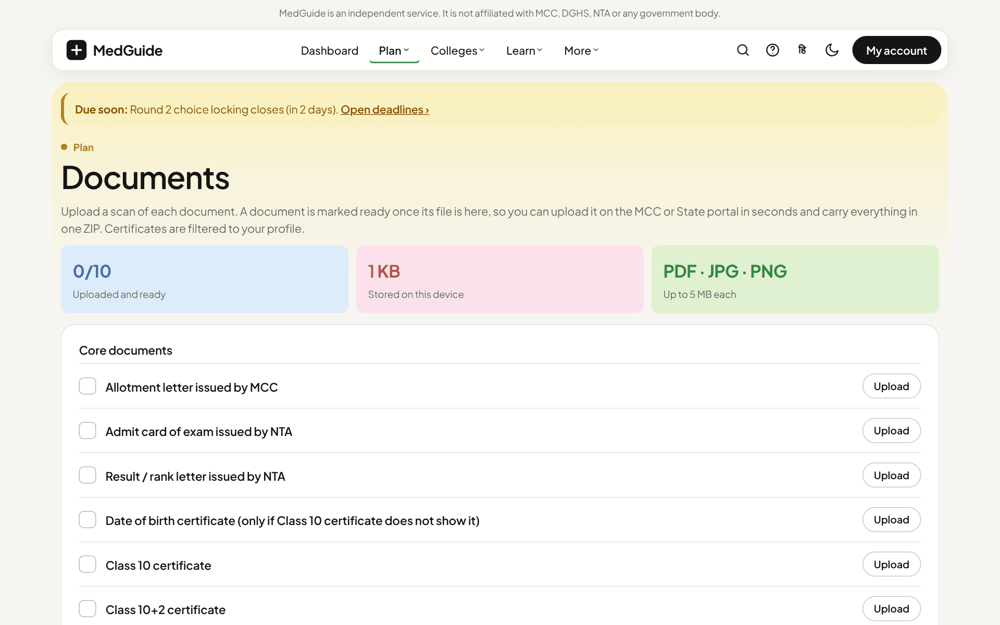<p align="center"><b>Documents</b></p></td>
    <td>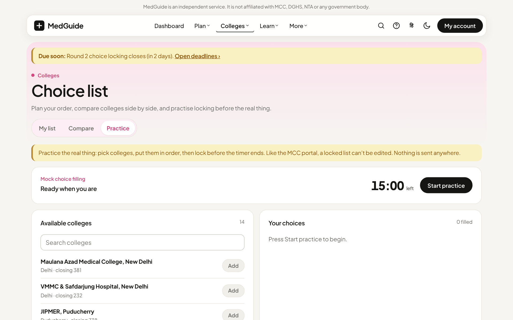<p align="center"><b>Mock choice filling</b></p></td>
  </tr>
  <tr>
    <td>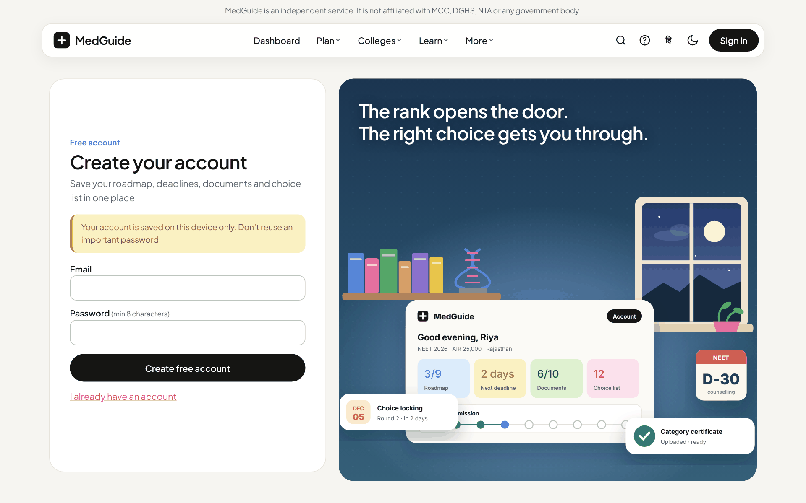<p align="center"><b>Sign up</b></p></td>
    <td>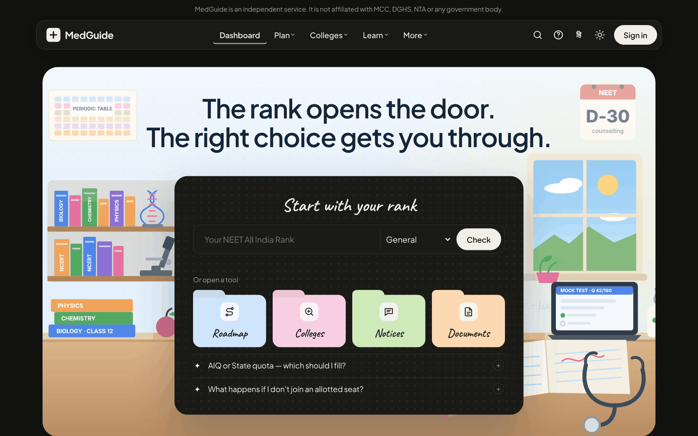<p align="center"><b>Dark mode</b></p></td>
  </tr>
</table>

<p align="center">
  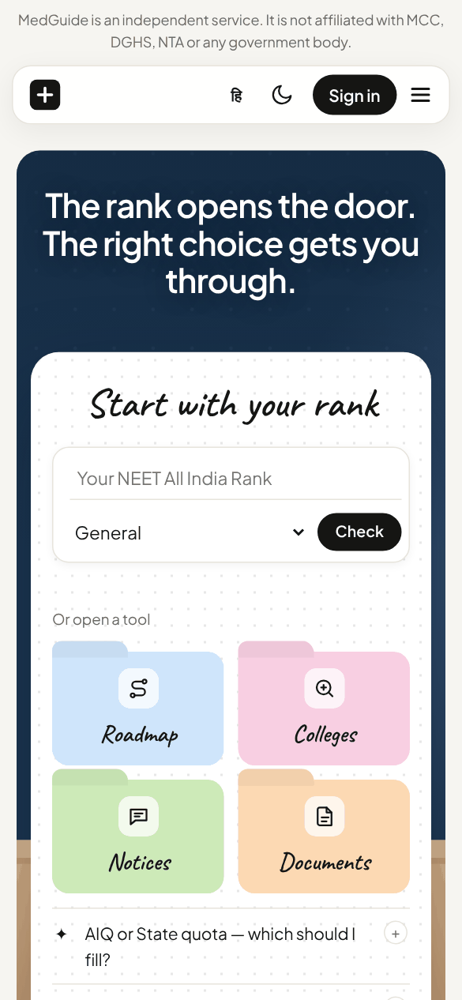
  &nbsp;&nbsp;
  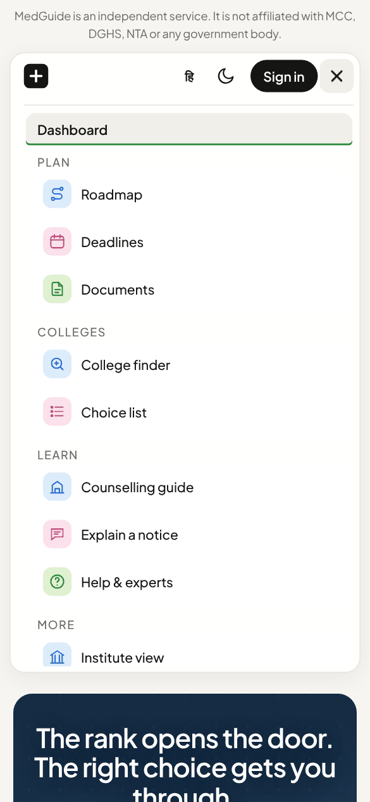
</p>

## Tech stack

- **HTML, CSS and vanilla JavaScript.** No framework, build step or package install.
- **Browser storage:** `localStorage` for accounts and entries, `IndexedDB` for uploaded document scans, and Web Crypto (SHA-256) for password hashing.
- **Bundled libraries** (in `js/vendor/`, loaded only when needed):
  - [PDF.js](https://mozilla.github.io/pdf.js/) 3.11.174 (Apache-2.0) reads notice PDFs.
  - [JSZip](https://stuk.github.io/jszip/) 3.10.1 (MIT or GPLv3) builds the documents ZIP.
- **Fonts:** Plus Jakarta Sans and Caveat, from Google Fonts.

## Getting started

**Prerequisites:** a modern browser, plus either Python 3 or Node.js to run a local server.

```bash
git clone https://github.com/HarshitaShibe/MedGuide.git
cd MedGuide
```

Then start a local server from the project folder.

With Python:

```bash
python -m http.server 8000
```

Or with Node.js:

```bash
npx serve .
```

Open **http://localhost:8000**, or the address `serve` prints.

Use a local server rather than opening `index.html` directly. PDF reading and document storage need an `http://` address.

**Try it out:**
1. Create an account and add your NEET details.
2. Open **Explain a notice** and upload `samples/sample-mcc-notice-round3.pdf`.

### Deploy

The site is fully static and is deployed on **Vercel** at [medguide-beryl.vercel.app](https://medguide-beryl.vercel.app/). It uses the "Other" preset with no build command, and every push to `main` redeploys it. It can be hosted just as easily on GitHub Pages or Netlify.

## Project structure

```
MedGuide/
├── index.html              Dashboard (home page)
├── roadmap.html            One small HTML shell per page; content is rendered by js/pages/
├── deadlines.html          
├── documents.html
├── predict.html            College finder
├── choices.html            Choice list · Compare · Mock practice
├── counselling.html        Counselling guide (AIQ, State, rules & fees, after allotment)
├── notice.html             Explain a notice
├── help.html               Help & experts
├── institute.html          Institute view
├── pricing.html            Plans
├── signin.html  profile.html  account.html  parent.html  privacy.html
├── css/
│   └── style.css           All styles; theme colours are CSS variables
├── js/
│   ├── data.js             Counselling data: categories, documents, closing ranks, State authorities, Q&A
│   ├── i18n.js             Hindi translations
│   ├── core.js             Shared code: storage, accounts, navigation, roadmap, deadlines, rendering
│   ├── pages/              One script per page or tab
│   └── vendor/             PDF.js and JSZip
├── docs/
│   ├── screenshots/        Images used in this README
│   └── demo/               1-minute demo video and its thumbnail
└── samples/                Sample MCC notice for testing "Explain a notice"
```

Every HTML page loads `data.js`, `i18n.js`, `core.js` and its own scripts from `js/pages/`. Each page script registers a render function, and `core.js` draws the page, navigation and footer.

## Configuration

Optional settings are at the top of `js/data.js`:

| Constant | Purpose |
|---|---|
| `EXPERT_WHATSAPP` | WhatsApp number that receives expert-session requests, e.g. `"919876543210"`. |
| `PAYMENT_LINK` | A payment link (e.g. Razorpay) for the Premium plan. |
| `VERIFIED` | The date official links were last checked; shown in the footer. |

No API keys or server are required.

## Data and privacy

- **Where data lives:** accounts, details, deadlines and uploaded scans stay in the browser on that device. Nothing is sent to a server. Use **My account → Download backup** before switching devices.
- **Sources:**
  - Rules and fees are summarised from the MCC UG Counselling 2026 Information Bulletin (revised 20.08.2026).
  - Closing ranks are compiled from published MCC allotment analyses.
- **Limits:** MedGuide never registers, fills or locks choices on anyone's behalf, and cannot guarantee admission.

## Developer

Designed and developed by **Harshita Shibe**: [LinkedIn](https://www.linkedin.com/in/harshita-shibe-a53488327/)
